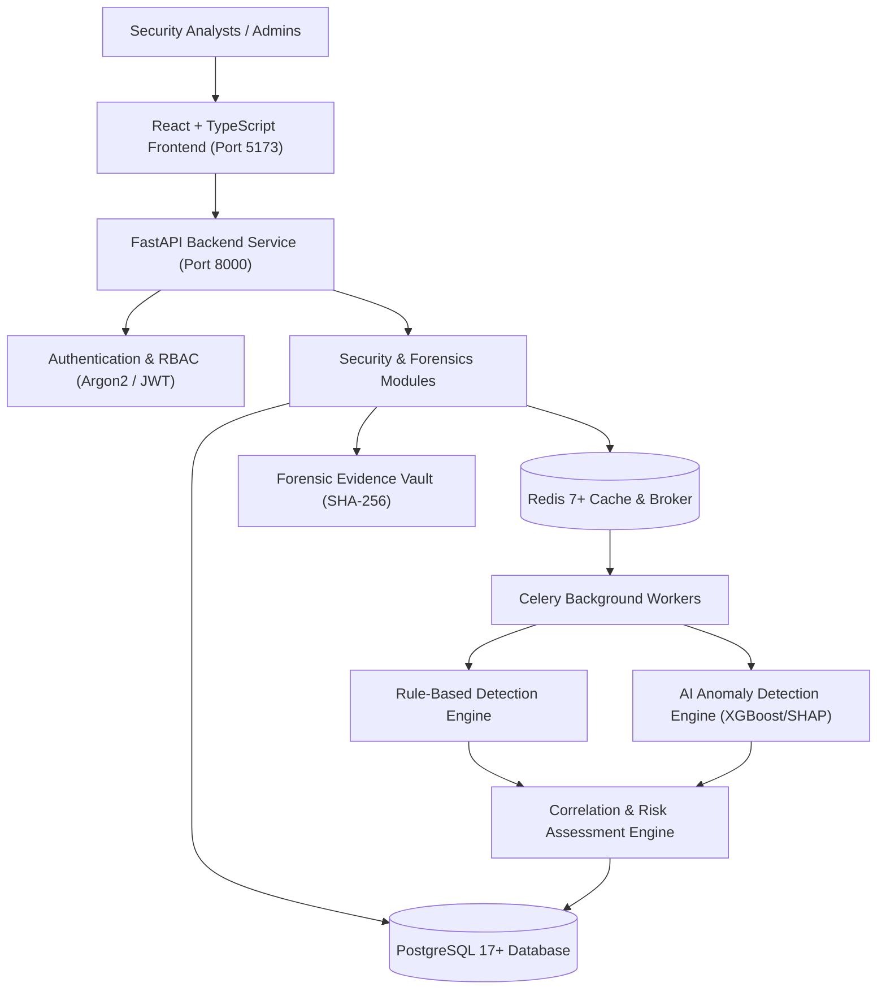

# AegisFlow — Cybersecurity Defense & Digital Forensics Platform

[](https://fastapi.tiangolo.com)
[](https://www.python.org/)
[](https://reactjs.org/)
[](https://www.typescriptlang.org/)
[](https://www.postgresql.org/)
[](https://www.docker.com/)

AegisFlow is an integrated cybersecurity management, digital forensics, and threat intelligence platform. It combines traditional rule-based detection with machine learning anomaly detection to correlate security findings, analyze vulnerabilities, preserve digital evidence, and triage security incidents in modern IT and cloud environments.

---

## 1. System Architecture



### Hybrid Detection Philosophy
- **Rule-Based Engine**: Validates known indicators of compromise (IOCs), brute force patterns, unapproved network connections, CVE signatures, and YARA rule matches on disk artifacts.
- **AI-Based Engine**: Baseline behavior profiling, abnormal login patterns, anomalous event frequencies, and suspicious traffic classification.
- **Correlation Engine**: Fuses rule matches with machine-learning confidence scores to produce actionable incident investigations while reducing alert fatigue.

---

## 2. Technology Stack

- **Backend**: Python 3.12+, FastAPI, Pydantic v2, SQLAlchemy 2, Alembic, Argon2-cffi, PyJWT
- **Frontend**: React 19, TypeScript, Vite, Tailwind CSS v4, Lucide React, Recharts, TanStack Query
- **Data & Processing**: PostgreSQL 17+, Redis 7+, Celery async task workers
- **Cybersecurity & AI**: Scapy, YARA, Scikit-learn, XGBoost, SHAP, NetworkX, Pandas
- **Infrastructure**: Docker Compose, GitHub Actions, Pytest, Ruff

---

## 3. Project Directory Structure

```
AegisFlow/
├── backend/
│   ├── app/
│   │   ├── api/v1/endpoints/   # Versioned API routes
│   │   ├── core/               # Configuration, security, permissions
│   │   ├── database/           # Engine, sessions, migrations
│   │   ├── models/             # SQLAlchemy ORM definitions
│   │   ├── schemas/            # Pydantic request/response schemas
│   │   ├── modules/            # Domain modules (auth, assets, vulns, forensics, etc.)
│   │   ├── services/           # Reusable business logic
│   │   └── workers/            # Celery background workers
│   ├── tests/                  # Pytest unit and integration test suite
│   ├── Dockerfile
│   └── requirements.txt
├── frontend/
│   ├── src/                    # React + TypeScript components & pages
│   ├── public/
│   ├── package.json
│   └── vite.config.ts
├── ai_engine/
│   ├── datasets/               # Training & evaluation datasets
│   ├── preprocessing/          # Data sanitization pipelines
│   ├── feature_engineering/    # Feature extraction & encoding
│   ├── training/               # Offline model training scripts
│   ├── models/                 # Serialized model artifacts
│   ├── evaluation/             # Confusion matrices, ROC-AUC metrics
│   └── explainability/         # SHAP explanation routines
├── infrastructure/
│   ├── docker/                 # Container configs
│   └── monitoring/             # Health metrics & telemetry
├── docs/                       # Architecture diagrams, specifications, and evidence formats
├── scripts/                    # Utility, seed, and administration scripts
├── docker-compose.yml          # Container orchestration (API, PostgreSQL, Redis)
├── .env.example                # Template environment variables
└── README.md
```

---

## 4. Development Quickstart

### Prerequisites
- [Python 3.12+](https://www.python.org/downloads/)
- [Node.js 20+ LTS](https://nodejs.org/)
- [Docker Desktop](https://www.docker.com/products/docker-desktop/) *(Optional for local database)*

### 1. Backend Setup
```powershell
# In AegisFlow root:
python -m venv .venv
.\.venv\Scripts\Activate.ps1
pip install -r backend/requirements.txt

# Run the API server
python -m uvicorn backend.app.main:app --reload
```
- API Endpoint: `http://localhost:8000`
- Interactive Swagger Docs: `http://localhost:8000/docs`
- Health Check: `http://localhost:8000/api/v1/health`

### 2. Frontend Setup
```powershell
cd frontend
npm install
npm run dev
```
- Web Application: `http://localhost:5173`

### 3. Database & Redis via Docker Compose
```powershell
# Copy environment configuration
Copy-Item .env.example .env

# Start PostgreSQL and Redis containers
docker compose up -d db redis
```

---

## 5. Development Roadmap

- [x] **Phase 1 – Foundation**: Repository initialization, directory trees, FastAPI scaffold, React+TS frontend, Docker Compose configuration.
- [x] **Phase 2 – Database & Authentication**: SQLAlchemy models, Alembic migrations, Argon2 password hashing, JWT authentication, and RBAC (Admin, Analyst, Viewer).
- [x] **Phase 3 – Asset Management**: Host discovery, IP tracking, OS fingerprinting, and asset inventory dashboard.
- [x] **Phase 4 – Vulnerability Management**: CVE database integration, version matching, and CVSS scoring.
- [x] **Phase 5 – Security Monitoring**: Network packet parsing (Scapy), log ingestion, and rule-based alert triggering.
- [x] **Phase 6 – AI Intelligence**: Model training, anomaly detection (XGBoost), and explainable risk scores (SHAP).
- [x] **Phase 7 – Digital Forensics**: SHA-256 evidence hashing, PE/ELF metadata analysis, and YARA rule scanning.
- [x] **Phase 8 – Incident Investigation**: Alert correlation into incidents, timeline builder, and evidence chain-of-custody.
- [x] **Phase 9 – Professional Release**: Executive PDF reports, end-to-end testing, and production Docker deployment.
